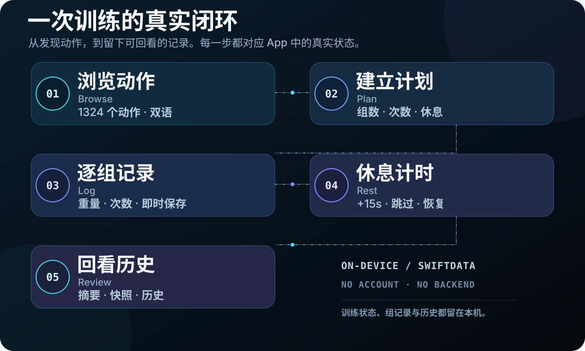

<p align="center">
  
</p>

<h1 align="center">FitGuide · 健身动作指导</h1>

<p align="center">
  <strong>从动作参考，到完整训练记录。</strong><br />
  一个离线优先的 iOS SwiftUI 健身动作指导与训练记录 App
</p>

<p align="center">
  <a href="https://developer.apple.com/ios/ios-18/"></a>
  <a href="https://www.swift.org/"></a>
  <a href="https://developer.apple.com/xcode/swiftui/"></a>
  
</p>

<p align="center">
  <a href="#快速开始">快速开始</a> ·
  <a href="#产品闭环">产品闭环</a> ·
  <a href="#核心能力">核心能力</a> ·
  <a href="#开发与测试">开发与测试</a>
</p>

<p align="center">
  
</p>

<p align="center"><sub>深空背景 + Liquid Glass 视觉语言；上图为基于真实功能结构绘制的 README 示意，不是运行时截图。</sub></p>

> FitGuide 是个人学习 / 作品集项目，不上 App Store 公开发行。它不需要账号或后端，动作资料与训练记录默认留在本机。

## 这是什么

FitGuide 把一次真实训练需要的几个动作串成一个安静、连续的闭环：先在动作库里找到动作，再用计划或自由训练开始一组组记录，完成后留下摘要与历史。

它保留了动作字典的清晰度，也补上了训练记录最容易断掉的部分：计划是可复用模板，每次训练拥有独立快照，重量、次数和休息状态会随着训练即时保存。

## 产品闭环

<p align="center">
  
</p>

一次训练的主路径是：

`浏览动作` → `建立计划 / 快速开始` → `逐组记录` → `休息计时` → `训练摘要与历史`

## 核心能力

### 动作库 / Exercise Library

- 内置 **1324 个动作**，本地 Bundle 加载，离线可用。
- 中文与英文始终并排展示；详情页按编号呈现双语步骤、GIF、动作元数据与版权页脚。
- 支持按中英文动作名、目标肌群、器械、身体部位搜索，并用多选 chip 组合筛选。
- 首页按身体部位分组，自动保留最近浏览的动作。

### 训练闭环 / Workout Loop

- **训练** Tab 提供继续训练、快速开始、计划模板、最近训练与完整历史入口。
- 计划支持动作顺序、组数、次数和休息时间；开始训练时复制成独立快照，不会反向修改模板。
- 全屏训练模式按动作与组导航，支持逐组记录重量 / 次数、撤销、跳过、调整组数与动作顺序。
- 休息计时支持自动开始、暂停、继续、跳过与 `+15s`；切换后台后按目标结束时间恢复。
- 完训后生成训练摘要，并从持久化的组记录计算动作数、组数、次数与总训练量。
- 支持 iOS 实时活动，在锁屏与灵动岛展示进行中的动作、组进度与休息倒计时。

### 本地优先 / Built for Trust

- SwiftData 保存训练计划、进行中的 Session、逐组记录与训练历史。
- 不引入账号、订阅、社交、云同步、数据导出或联网依赖。
- 训练期间始终可以回到原动作详情，版权署名路径不会被训练模式截断。
- 以可访问性、Reduce Motion、对比度和数据迁移为测试与设计约束，而不是事后补丁。

## 技术选择

| 层级 | 方案 | 在 FitGuide 中负责什么 |
| --- | --- | --- |
| UI | SwiftUI | 深空背景、Liquid Glass 卡片、三 Tab 信息架构与训练全屏流程 |
| 状态 | `ExerciseStore` / `LibraryStore` / `ActiveWorkoutStore` | 动作检索、计划模板、训练 Session、计时器与历史 |
| 持久化 | SwiftData | 计划、快照、逐组记录、训练摘要与 v1 → v2 兼容迁移 |
| 系统能力 | Live Activity | 锁屏与灵动岛的训练状态、动作与休息倒计时 |
| 工程 | XcodeGen | 从 `project.yml` 生成 Xcode 工程，避免提交生成文件 |

## 快速开始

### 1. 准备动作数据集

动作 JSON、图片与 GIF 不随本仓库公开分发。请根据数据集授权，将 `exercises-dataset/` 放到仓库同级目录：

```text
健身动作指导/
├── exercises-dataset/       # data/、images/、videos/；含 Gym visual 媒体
└── FitGuide/                # 本仓库
```

### 2. 生成工程并构建

环境要求：macOS、Xcode、Homebrew，以及可运行 iOS 18+ 模拟器的 Xcode SDK。

```bash
brew install xcodegen                    # 一次性

cd FitGuide
xcodegen generate

xcodebuild \
  -project FitGuide.xcodeproj \
  -scheme FitGuide \
  -sdk iphonesimulator \
  -destination 'platform=iOS Simulator,name=iPhone 17' \
  CODE_SIGNING_ALLOWED=NO build
```

`FitGuide.xcodeproj/` 是生成文件，已在 `.gitignore` 中排除。若本机的模拟器名称不同，可在 Xcode 中选择对应的 iOS 18+ iPhone 目标。

## 开发与测试

完整测试命令：

```bash
xcodebuild \
  -project FitGuide.xcodeproj \
  -scheme FitGuide \
  -sdk iphonesimulator \
  -destination 'platform=iOS Simulator,name=iPhone 17' \
  CODE_SIGNING_ALLOWED=NO test
```

自动化覆盖包括：

- `AttributionTests`：每个动作必须保留 `© Gym visual` 署名与来源链接。
- `WorkoutStoreTests`：计划快照、逐组记录、撤销、训练状态、计时器、迁移、分页和级联删除。
- `PerformanceTests`：JSON / GIF / 缩略图加载、搜索筛选、冷启动与 1000 条训练历史首屏查询。
- `FitGuideUITests`：计划训练、自由训练、后台恢复、冷启动恢复、完成 / 放弃与历史回看，以及关键无障碍流程。

更多 v2.0 背景与已知限制见 [RELEASE_NOTES_V2.0.md](RELEASE_NOTES_V2.0.md)，维护约束见 [AGENTS.md](AGENTS.md)。

## 项目结构

```text
FitGuide/
├── FitGuideApp.swift                 # ModelContainer 与三个 Store 的入口
├── Models/                           # 动作、计划、Session、组记录模型
├── Stores/                           # 动作检索、计划库、训练状态机
├── Views/
│   ├── Components/                   # SpaceBackground、GlassCard、GIF、双语步骤
│   ├── Tabs/                         # 动作 / 训练 / 我的
│   ├── Detail/                       # 动作详情、分享、加入计划
│   ├── Plans/                        # 计划、训练过程、历史与摘要
│   └── Settings/                     # 设置、关于、版权说明
├── FitGuideLiveActivity/             # 锁屏与灵动岛展示
├── FitGuideTests/                    # 单元、性能与迁移测试
├── FitGuideUITests/                  # 关键用户流程与无障碍回归
├── project.yml                       # XcodeGen 配置
└── assets/readme/                    # README 首页的本地 SVG 视觉资产
```

## 数据、版权与边界

- 代码采用 MIT License；仓库当前未附独立 `LICENSE` 文件，请以仓库代码版权声明为准。
- 动作图片、GIF、JSON 数据集来自 [Gym visual](https://gymvisual.com/)，应用内必须显示 `© Gym visual — https://gymvisual.com/`，请按其条款使用。
- 训练数据只保存在本机；删除 App 或系统清除数据后无法恢复，当前版本没有云同步、导出、后台通知或跨设备同步。
- v2.0 的 Live Activity 负责展示状态与倒计时，不等同于后台通知；iOS 18 fallback、真实设备训练、手动 VoiceOver 与 Instruments 仍属于发布前验证项。

## v1 → v2 数据策略

<details>
<summary>展开查看兼容迁移说明</summary>

v2 在同一个 SwiftData store 中增加训练历史模型。新增计划字段采用可选持久化列并在启动时补齐默认值，因此既有 v1 数据可以轻量迁移。

旧 `FavoriteList` / `FavoriteItem` 表、`setStatesRaw` 与 `completedAt` 字段仅为打开旧数据库而保留；v2 UI 不再展示或写入收藏，也不会把旧版勾选状态伪造成训练历史。每次新训练会创建自己的 `WorkoutSession`、`WorkoutExercise` 与 `SetLog` 快照。

</details>

## 作者

**HanaAyane** · [GitHub](https://github.com/HanaAyane)

如果你在研究 SwiftUI、SwiftData、离线内容打包或一套完整训练状态机，欢迎从 [V2_DESIGN_BRIEF.md](.design/fitness-app/V2_DESIGN_BRIEF.md) 开始阅读设计取舍。

## 版本

- `v2.0`：完整训练闭环，开发分支为 `v2.0`
- `v1.0`：首个完整版本，保留为 git tag
