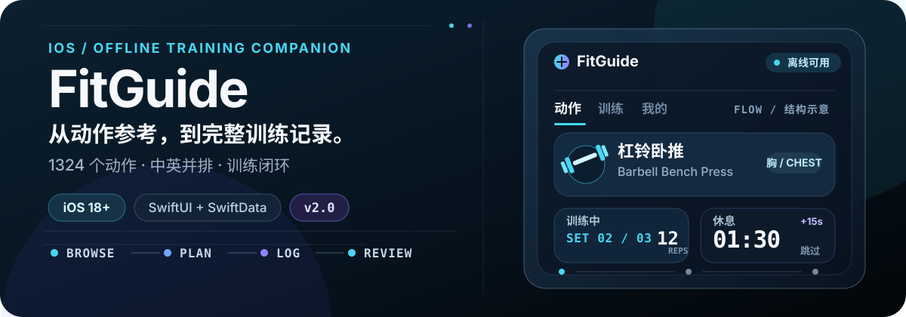

<p align="center">
  
</p>

<h1 align="center">FitGuide · 健身动作指导</h1>

<p align="center">
  <strong>从动作参考，到完整训练记录。</strong><br />
  一个离线优先的 iOS SwiftUI 健身动作指导与训练记录 App
</p>

<p align="center">
  <a href="https://developer.apple.com/ios/ios-18/"></a>
  <a href="https://www.swift.org/"></a>
  <a href="https://developer.apple.com/xcode/swiftui/"></a>
  
</p>

<p align="center">
  <a href="#快速开始">快速开始</a> ·
  <a href="#1-准备动作数据集">动作数据集</a> ·
  <a href="#从查动作到记训练">训练流程</a> ·
  <a href="#2-构建与测试">构建与测试</a>
</p>


FitGuide 是一个面向 iPhone 的离线健身动作库和训练记录 App。查阅 1324 个动作的 GIF 示范和中英对照步骤，按计划或自由开始训练，记录每组重量和次数，练完回看摘要和历史。

## 从查动作到记训练



<sub>FitGuide 2.0 的动作详情、单组记录和休息计时界面示意。</sub>

- **找动作**。按身体部位浏览，用中文或英文搜索，或组合筛选部位、器械和目标肌群。动作详情同时显示 GIF 示范和中英对照步骤。
- **记训练**。套用计划模板或快速开始自由训练，逐组记录重量和次数。开始训练时会复制一份计划，之后调整动作顺序和组数也能保留原模板。
- **计休息**。支持暂停、继续、跳过和延长 15 秒。锁屏和灵动岛可通过实时活动显示当前动作、组进度与倒计时。
- **回看历史**。完训后查看动作数、组数、次数和总训练量，或打开历史详情查看每组记录。


动作库和训练记录都可离线使用，训练数据通过 SwiftData 保存在本机。界面在 iOS 26 及以上使用原生 Liquid Glass，在早期兼容版本使用毛玻璃样式。

## 快速开始

### 1. 准备动作数据集

FitGuide 构建时会把动作 JSON、缩略图和 GIF 打包到 App 里。首次构建前，请阅读上游的媒体使用条款，再前往数据集仓库选择 **Code → Download ZIP**。解压后将文件夹重命名为 `exercises-dataset`，放到 `FitGuide` 仓库文件夹旁边。[动作数据集仓库](https://github.com/hasaneyldrm/exercises-dataset) · [媒体使用条款](https://github.com/hasaneyldrm/exercises-dataset/blob/main/NOTICE.md)

如果使用 Git，在 `FitGuide` 仓库目录运行下面的命令即可下载到同级目录。

```bash
git clone --depth 1 https://github.com/hasaneyldrm/exercises-dataset.git ../exercises-dataset
```

构建前确认以下目录结构，确保 `data`、`images` 和 `videos` 就在 `exercises-dataset/` 下。

```text
健身动作指导/
├── exercises-dataset/
│   ├── data/exercises.json
│   ├── images/
│   └── videos/
└── FitGuide/
```

### 2. 构建与测试

需要 macOS、带 iOS 26 或更新 SDK 的 Xcode、Homebrew 和已安装的 iOS 模拟器。在 `FitGuide/` 仓库目录运行以下命令。如果本机使用其他模拟器，替换目标中的设备名。

```bash
brew install xcodegen
xcodegen generate
xcodebuild -project FitGuide.xcodeproj -scheme FitGuide \
  -destination 'platform=iOS Simulator,name=iPhone 17' \
  CODE_SIGNING_ALLOWED=NO build
```

<details>
<summary>运行测试</summary>

```bash
xcodebuild -project FitGuide.xcodeproj -scheme FitGuide \
  -destination 'platform=iOS Simulator,name=iPhone 17' \
  CODE_SIGNING_ALLOWED=NO test
```

测试覆盖动作数据和版权署名、加载与搜索性能、训练状态与迁移，以及从开始训练到回看历史的关键界面流程。

</details>

## 从 v1.0 升级

保留现有训练计划、动作参数和最近浏览。v1 的收藏记录保留在旧数据表中，v2 界面已移除收藏入口。训练历史从升级后的训练开始记录。迁移细节和当前限制见 [2.0 版本说明](RELEASE_NOTES_V2.0.md)。

## 项目文档

- [v2.0 GitHub Release](https://github.com/HanaAyane/FitGuide/releases/tag/v2.0) · [2.0 版本说明](RELEASE_NOTES_V2.0.md)
- [v1.0 标签](https://github.com/HanaAyane/FitGuide/tree/refs/tags/v1.0)
- [2.0 设计说明](.design/fitness-app/V2_DESIGN_BRIEF.md) · [开发清单](.design/fitness-app/V2_TASKS.md) · [维护指南](AGENTS.md)

## 作者与许可

仓库作者 · [HanaAyane](https://github.com/HanaAyane)

代码采用 MIT 许可，项目用于个人学习和作品集展示。动作图片和 GIF 的版权归 Gym visual 所有。请按上游条款使用媒体，并保留动作详情、设置和关于页中的版权署名。[Gym visual](https://gymvisual.com/)
