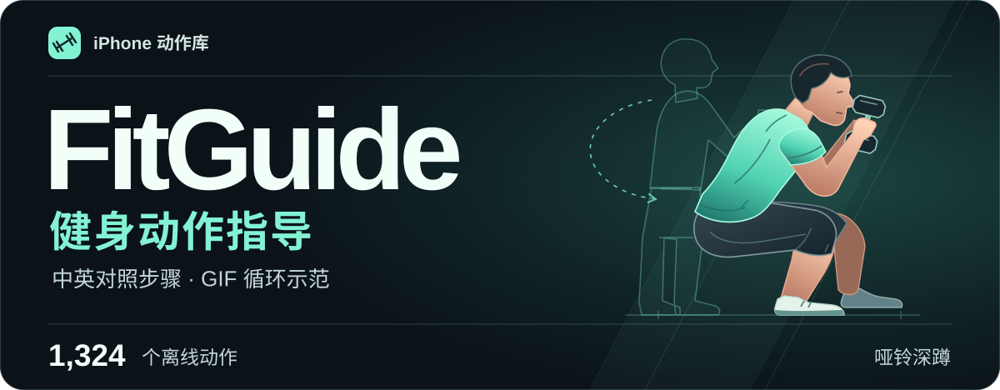

# FitGuide · 健身动作指导



FitGuide 是一个面向 iPhone 的离线健身动作库，内置 1324 个动作。按身体部位查找动作，在同一页看 GIF 示范和中英对照步骤，再收藏动作或加入训练计划。

**iPhone · iOS 18+ · SwiftUI + SwiftData**

默认分支 `main` 对应 v1.0。逐组记录、休息计时、训练历史与锁屏实时活动见 [FitGuide 2.0](https://github.com/HanaAyane/FitGuide/tree/v2.0)。

## 在健身房怎么用

1. **找动作**。按身体部位浏览，输入中文或英文动作名，也可以用部位、器械和目标肌群组合筛选。
2. **看要领**。在动作详情页看循环 GIF、目标肌群和器械信息。每个步骤都同时显示中文和英文。
3. **排计划**。收藏常用动作，或把动作加入训练计划，按组标记完成。需要分享时，可以复制双语步骤。

动作库、图片和 GIF 随 App 安装后可离线使用，收藏与计划保存在本机。界面采用深色背景，iOS 26 及以上使用原生 Liquid Glass，iOS 18 使用毛玻璃样式。

## 本地构建

需要 macOS、Xcode、Homebrew 和 iOS 模拟器。数据集需自行按媒体授权准备，再放到仓库旁边。

```text
健身动作指导/
├── exercises-dataset/
│   ├── data/exercises.json
│   ├── images/
│   └── videos/
└── FitGuide/
```

在 `FitGuide/` 仓库目录运行以下命令。如果本机使用其他模拟器，替换目标中的设备名。

```bash
brew install xcodegen
xcodegen generate
xcodebuild -project FitGuide.xcodeproj -scheme FitGuide \
  -destination 'platform=iOS Simulator,name=iPhone 17' \
  CODE_SIGNING_ALLOWED=NO build
```

<details>
<summary>运行测试</summary>

```bash
xcodebuild -project FitGuide.xcodeproj -scheme FitGuide \
  -destination 'platform=iOS Simulator,name=iPhone 17' \
  CODE_SIGNING_ALLOWED=NO test
```

`AttributionTests` 检查动作数据和界面中的版权署名。`PerformanceTests` 覆盖动作库加载、搜索、缩略图和 GIF 解码。

</details>

## 项目文档

- [v1.0 标签](https://github.com/HanaAyane/FitGuide/tree/v1.0)
- [v2.0 版本说明](https://github.com/HanaAyane/FitGuide/blob/v2.0/RELEASE_NOTES_V2.0.md)
- [设计说明](.design/fitness-app/DESIGN_BRIEF.md) · [任务清单](.design/fitness-app/TASKS.md) · [维护指南](AGENTS.md)

## 作者与许可

作者为HanaAyane。代码采用 MIT 许可，项目用于个人学习与作品集展示。动作图片、GIF 和数据集由 Gym visual 提供，按其条款使用。请保留动作详情、设置与关于页中的版权署名。[作者主页](https://github.com/HanaAyane) · [Gym visual](https://gymvisual.com/)
